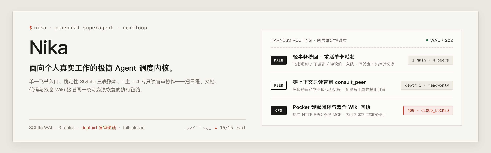
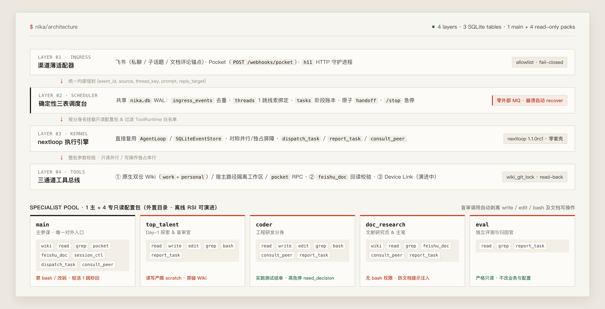

<div align="center">
  
  <br><br>
  <p>
    
    <a href="https://github.com/12bitsD/nextloop"></a>
    
    
    
  </p>
  <p>
    <a href="#为什么做-nika">为什么做</a> ·
    <a href="#怎么工作">怎么工作</a> ·
    <a href="#架构与分身一览">架构与分身</a> ·
    <a href="#快速开始与验证">快速开始</a> ·
    <a href="#运维与目录结构">运维与目录</a>
  </p>
</div>

---

## 为什么做 Nika

很多个人 Agent 框架要么把调度状态全交给模型自由文本去猜，一跑多步就丢上下文或重复副作用；要么动辄拉起消息队列、向量库和一堆聊天机器人账号，维护成本比干活本身还高。

Nika 的出发点很朴素：**只面向单一用户的真实工作，把确定性的事交给纯代码和 SQLite，把思考和执行交给 [`nextloop`](https://github.com/12bitsD/nextloop)**。

不在外面堆花哨的框架仪式，而是把飞书（私聊、子话题、文档评论）、[Pocket](https://github.com/12bitsD/pocket) 日程待办、本地代码库与现有双仓 Git Wiki 接进同一条**可崩溃恢复、可独立盲审、不打扰日常**的执行链路。

---

## 怎么工作

Nika 围绕「一个人怎么和自己的主参谋及专职分身顺手配合」设计了 4 个核心机制：

### 1. 单一入口进门，确定性 3 表调度 + 1 跳直达分身
对外永远只有一个 Nika，不拆一堆 IM 账号。所有入站事件经薄适配器归一化后写入单库 WAL 模式的 `nika.db`（仅新增 3 张调度表，其余事件日志归 `nextloop` 独占）：
- **`ingress_events`**：按 `event_id` 主键防重，平台重推直接幂等吸收；
- **`threads`**：隔离飞书私聊 / 子话题 / 文档评论 / Pocket 投递线索。轻事务由 `main` 秒回，重任务派单后原位刷新单张状态卡；后续在同一话题追问直接 **1 跳路由到原分身**，不绕道 `main`；
- **`tasks`**：维护任务阶段账本（`queued` / `running` / `need_decision` / `blocked` / `done` / `failed`）。分身遇到越界请求（如研发话题里顺手建日程）调 `report_task(status="handoff")`，在**同一 SQLite 事务内原子创建 `main` 接手任务**并切主，发送 `/stop` 随时急停并级联取消子调用。

### 2. 零上下文只读盲审（`consult_peer`，硬锁 `depth=1`）
内部协作收敛为 3 个工具：`dispatch_task`（仅 `main`）、`report_task`（仅 4 个分身）和 `consult_peer`（`main` / `coder` / `doc_research` 可用）：
- 盲审只传待审产物与具体问题，**不携带对话历史、私密上下文或倾向性引导**；
- 运行时对盲审会话强制剥离 `write` / `edit` / `bash`、`pocket` 等变更工具，并在 `wiki` / `feishu_doc` 内拦截一切写操作；
- 代码层硬锁 `depth=1` 并禁止同分身自审（如 `coder -> coder`），从根上杜绝套娃死循环。

### 3. 原生打通飞书文档、Pocket 与双仓 Wiki（默认静默）
- **双仓 Wiki 合一**：不另造第三套私有 Wiki 或 Vector DB，直接挂载现有 `work` 与 `personal` 两个 Git 仓；先搜二级标题行号范围（H2-TOC）再按行精准 `read`，写入与撤回受 `wiki_git_lock` 串行保护并附带真实 `rev <short_sha>` 回执；
- **Pocket 双向极简接入**：不包 MCP，给 `main` 配原生 `pocket(method, params)` HTTP 工具直连 `/v1/rpc/{method}`（只读并行、写操作自动带幂等 `request_id` 独占执行）；撞到手机端本机锁 `409 CLOUD_LOCKED` 立即停手如实告知；入站 `/webhooks/pocket` 落库即回 `202 Accepted`，跑完默认静默回写摘要，仅在要求提醒或异常卡住时才推飞书；
- **飞书文档锚点与回读校验**：评论触发时自动切片锚点前后段落，按二级标题局部替换正文并在写后强制回读核验。

### 4. 崩溃可恢复、可实证、可离线进化
- **启动自愈（`recover()`）**：直接复用 `nextloop` 事件日志重投进程崩溃前尚未确认的 `FinalMessage`，清理中断卡死线程避免永久阻塞，并自动拉起持久化 `queued` 任务；
- **极简运维与离线 RSI**：基于 `h11` 的零框架 HTTP 守护进程（飞书 Webhook 默认 Fail-Closed 鉴权 + 300 秒防重放窗口）；提供 `nika check / backup / export / recover / serve`，热备与轨迹导出均走临时文件 `0600` 原子替换并自动脱敏密钥，方便独立 RSI 仓库离线迭代只读分身包。

---

## 架构与分身一览

<p align="center">
  
</p>

| 分身 | 角色定位 | 工具范围 | 硬边界 |
| --- | --- | --- | --- |
| **`main`** | 主参谋（唯一对外入口） | `wiki`, `read`, `grep`, `pocket`, `feishu_doc`, `session_ctl`, `dispatch_task`, `consult_peer` | 禁 `bash` / `write` / `edit`，保持轻活秒回与主会话干净 |
| **`top_talent`** | Day-1 探索先锋 & 盲审官 | `read`, `write`, `edit`, `grep`, `bash`, `report_task` | 读写严格隔离在 `scratch` 目录，禁碰主干与 Wiki |
| **`coder`** | 工程研发分身 | `read`, `write`, `edit`, `grep`, `bash`, `consult_peer`, `report_task` | 改码后须实跑测试通过才结单，高危破坏操作停在 `need_decision` |
| **`doc_research`** | 文献研究员 & 主笔 | `wiki`, `read`, `grep`, `feishu_doc`, `consult_peer`, `report_task` | 无 `bash` 与本地文件写入权限，防止外部文档提示注入 |
| **`eval`** | 独立评测与归因官 | `read`, `grep`, `report_task` | 严格只读，不修改业务代码与分身配置 |

---

## 快速开始与验证

需要 Python `3.11+` 与 `nextloop==1.1.0rc1`：

```sh
# 1. 安装依赖（可编辑模式）
python -m pip install -e .

# 2. 自检 nextloop 版本、5 个分身配置包、Skills 与 SQLite WAL 建表
nika check --db .local/nika.db

# 3. 启动本地 HTTP 守护进程（启动时自动执行崩溃恢复）
NIKA_FEISHU_ALLOWLIST="ou_your_open_id" \
NIKA_FEISHU_VERIFY_TOKEN="your_feishu_verify_token" \
NIKA_POCKET_WEBHOOK_SECRET="your_pocket_webhook_secret" \
nika serve --host 127.0.0.1 --port 8787 --db .local/nika.db
```

常驻 macOS 后台可直接参考 [`deploy/com.nika.daemon.plist`](deploy/com.nika.daemon.plist)（替换路径与环境变量后交由 `launchd` 托管）。

### 本地静态门禁与真模型全量验收

```sh
# 静态风格、类型、黑盒单测与卫生检查（bits / ruff / mypy --strict / pytest / hygiene）
./scripts/verify.sh

# 零 Mock 真模型端到端行为评测（覆盖 F0–F9 与本地 TCP HTTP 守护链路，共 16 用例）
python scripts/eval.py --stage 4
```

---

## 运维与目录结构

```sh
# 在线热备份 SQLite 数据库（PRAGMA integrity_check 校验 + 0600 原子替换）
nika backup --db .local/nika.db --out .local/backups/nika-latest.db

# 按分身导出脱敏后的 OpenAI Chat JSONL 轨迹（供离线 RSI 评测）
nika export --db .local/nika.db --out .local/exports

# 离线安全修复崩溃态（不误触发待跑队列，未确认终态消息标为 BLOCKED）
nika recover --db .local/nika.db
```

```text
nika/
├── src/nika/
│   ├── db.py                SQLite WAL 三表账本（ingress_events / threads / tasks）
│   ├── scheduler.py         确定性调度台、单卡进度桥接、/stop 级联取消与 recover()
│   ├── orchestration.py     report_task、原子 handoff 与只读 depth=1 consult_peer
│   ├── feishu.py            飞书入站鉴权、话题线索派生与原位状态卡节流
│   ├── feishu_doc.py        飞书文档章节解析与写后强制回读校验
│   ├── pocket.py            Pocket 原生 RPC 客户端、/webhooks/pocket 适配器与契约测试桩
│   ├── wiki.py              WorkWiki / personal 双仓挂载、H2-TOC 检索与 Git 回执
│   ├── workspace.py         宿主路径 containment、保护文件硬拦截与进程组隔离 bash
│   ├── sessions.py          基于 SQLite 的跨话题只读回忆（session_ctl）
│   ├── http_app.py          基于 h11 的极简 HTTP 服务（/healthz 与双 Webhook）
│   └── cli.py               nika check / backup / export / recover / serve 入口
├── specialists/             1 主 + 4 专只读配置包（pack.toml + prompt.md + 共享红线）
├── skills/                  按分身按需加载的 Skill（wiki / feishu_doc）
├── deploy/                  macOS launchd 常驻配置模板
├── scripts/                 verify.sh 门禁、hygiene 审计与零 Mock 真模型 eval.py
├── tests/                   Stage 0–4 黑盒回归与盲审故障注入测试套件
└── docs/                    架构定稿、设计决策、实施基线与展示素材
```

### 核心文档索引

- [`VISION.md`](VISION.md) — 产品目标、克制原则与能力边界
- [`docs/design/harness.md`](docs/design/harness.md) — 四层确定性调度、统一信封、Pocket 静默边界、三表账本与双仓 Wiki 设计基线
- [`docs/architecture/implementation-plan.md`](docs/architecture/implementation-plan.md) — 模块切分、SQLite DDL、阶段里程碑与验证闭环
- [`docs/design/agentwiki.md`](docs/design/agentwiki.md) · [`docs/design/proactive-and-feishu.md`](docs/design/proactive-and-feishu.md) — 双仓 Wiki 检索回执、评论锚点与原位状态卡设计
- [`CONTEXT.md`](CONTEXT.md) — 领域词汇表

> **公开仓库边界**：请勿提交任何真实密钥、私有 Wiki 内容、真实会话轨迹、内网地址或个人 `open_id`；`./scripts/verify.sh` 已内置自动化泄露扫描门禁。
